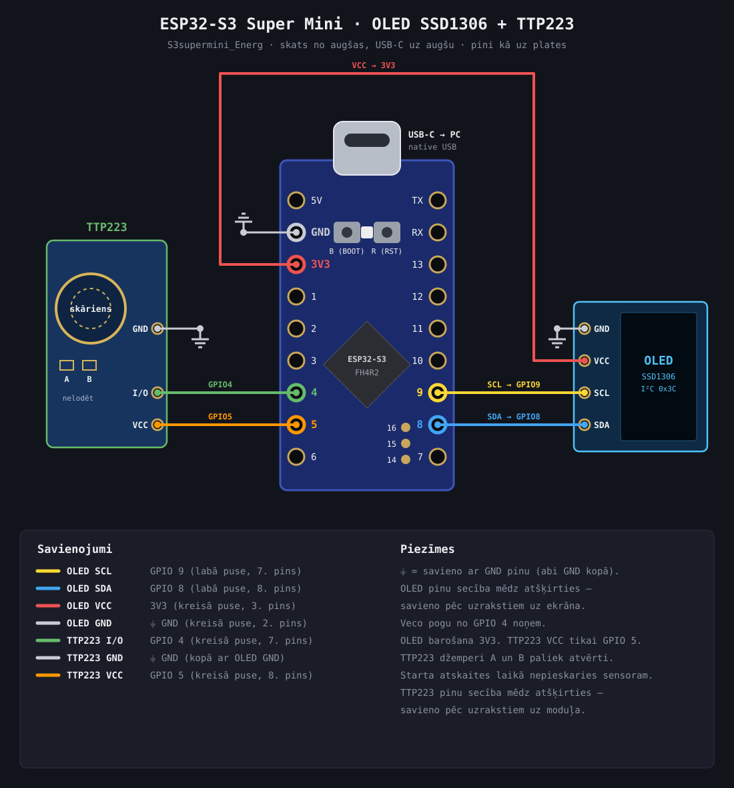

# S3supermini_Energ: elektrības un degvielas cenas uz galda

Kopija no [`S3supermini_VcSar5`](https://github.com/komuna7/S3supermini_VcSar5) ar to pašu
aparatūru (ESP32-S3 Super Mini, 0,96" OLED, TTP223 sensors) un to pašu Wi-Fi iestatīšanu.
Vilcienu saraksta vietā ekrāns pa kārtai rāda:

| Sadaļa | Ko rāda |
|---|---|
| **Elektrība** | Nord Pool biržas cena Latvijā šim brīdim (c/kWh, ar vai bez PVN), lētāko laiku nākamajās 24 h un stabiņu grafiku |
| **Gāze (LPG)** | Lētākā autogāzes cena stacijās, līdz kurām nokļūsti noteiktajā laikā, un tuvākā vieta ar šo cenu |
| **Benzīns** | Tas pats 95 vai 98 benzīnam (izvēlas lapā) |
| **Dīzeļdegviela** | Tas pats dīzelim |

Tīmekļa lapā katrai sadaļai var iestatīt, vai to rādīt un cik sekundes. Tur arī noliek savu
punktu kartē un norāda, cik minūtes esi gatavs braukt līdz stacijai.



## Ekrāni

```
ELEKTRIBA LV    14:15        AUTOGAZE      <15MIN
---------------------        ---------------------
 8.53  c/kWh                 0.799  EUR
       ar PVN                       /L
LETAKAIS 03:15 3.1           VIRSI           7MIN
▂▃▅▇█▇▅▃▂▁▁▂▃▅▆▇▆▅▃▂         RIGA, BRIVIBAS IELA
                             1
```

- Stabiņi sākas ar pašreizējo intervālu un sniedzas 24 h uz priekšu (no 2025. gada oktobra
  biržai ir 15 minūšu intervāli, tāpēc tie ir 96).
- Ja robežās nav nevienas stacijas ar šo degvielu, virsrakstā ir `TUVAKA`, un ekrāns rāda tuvāko
  staciju vispār. Aiz minūtēm tad ir `!`.
- Īss pieskāriens sensoram uzreiz pārslēdz uz nākamo sadaļu.
- Pirksts uz sensora 3 s: QR kods uz iestatījumu lapu. 15 s: restarts (kā oriģinālā).

## Kā izvēlas "lētāko tuvāko"

1. Attālumu līdz katrai stacijai rēķina taisnē un reizina ar **1,3**, jo ceļš ir garāks par taisni.
2. Laiks = attālums / **vidējais ātrums** (noklusējumā 50 km/h). Ar atzīmi *Turp un atpakaļ*
   laiks divkāršojas.
3. No stacijām, kuras sasniedz **maksimālajā laikā** (noklusējumā 15 min), izvēlas zemāko cenu.
   Ja vairākām ir vienāda cena, izvēlas tuvāko.

Karte lapā rāda sasniedzamo apli un stacijas ap punktu ar to cenām. Aplis ir aptuvens, jo ESP
nezina īsto ceļu tīklu.

## Datu avoti

### Elektrība

`https://dashboard.elering.ee/api/nps/price` (Igaunijas pārvades operators Elering publicē
Nord Pool dienas tirgus cenas visām Baltijas zonām, arī `lv`). Atslēga nav vajadzīga. ESP to
lasa ik pēc 30 minūtēm, pēc kļūdas pēc 3 minūtēm. Rītdienas cenas parādās ap 14:00 pēc Latvijas laika.

Cena ir tikai biržas daļa: bez tirgotāja uzcenojuma, sadales un OIK. PVN 21% pieskaita tikai
pozitīvai cenai.

### Degviela

Latvijā nav publiska API ar visu staciju cenām. Tīkli (Circle K, Neste, Virši, Viada) savās lapās
publicē **katras degvielas zemāko cenu un adreses, kurās tā ir spēkā**. ESP pats šīs lapas
nevar droši parsēt un adreses pārvērst koordinātās, tāpēc to dara skripts
[`tools/fuel_feed.py`](tools/fuel_feed.py), kas darbojas GitHub Actions
([`.github/workflows/energ-fuel.yml`](../.github/workflows/energ-fuel.yml)) ik pēc 2 stundām:

1. nolasa lapas no [`tools/fuel_sources.json`](tools/fuel_sources.json);
2. tabulās atrod degvielas nosaukumu, cenu un adreses;
3. adresēm atrod koordinātas ar OpenStreetMap Nominatim, rezultātu kešo
   `data/geocache.json`, lai katru adresi meklētu tikai vienreiz;
4. pievieno `data/manual_stations.json` (paša ievadītas stacijas vai labojumi);
5. ieraksta `data/fuel.json` un iesūta to repozitorijā.

ESP lasa `data/fuel.json` ik pēc stundas no
`https://raw.githubusercontent.com/komuna7/egg1/main/S3supermini_Energ/data/fuel.json`.
Adresi var nomainīt lapā, sadaļā **Dati**, piemēram, uz savu serveri.

Faila formāts (`updated` jābūt pirms `stations`, jo ESP lasa failu kā plūsmu):

```json
{"updated":"2026-11-26T10:00:00+00:00","stations":[
{"b":"Virši","a":"Rīga, Brīvības iela 1","lat":56.955,"lon":24.115,"p":{"95":1.599,"dd":1.519,"lpg":0.799}}
]}
```

Cenu atslēgas: `lpg`, `95`, `98`, `dd`. Trūkstošu degvielu vienkārši neieraksta.

`data/manual_stations.json` ir tādu pašu staciju saraksts (bez `updated`). Ar to var pievienot
stacijas, kuru tīklam nav lapas, vai salabot koordinātas.

## Web versija

[`web/index.html`](web/index.html) dara to pašu bez ierīces, pārlūkā: sadaļas mainās pa kārtai,
pieskāriens pārslēdz uz nākamo, **Pilnekrāns** rāda tikai ekrānu (piem., planšetei uz sienas).
Iestatījumi ir tādi paši kā ierīcei (sadaļas un sekundes, PVN, 95/98, punkts kartē, maksimālais
laiks, ātrums, turp un atpakaļ). Tos atceras pārlūks. Papildus ir poga **Mana atrašanās vieta**,
lētāko staciju tabula robežās un saite **Maršruts** uz Google Maps.

Kad zars ir apvienots ar `main`, GitHub Pages to publicē adresē
<https://komuna7.github.io/egg1/S3supermini_Energ/web/>. Lapu var atvērt arī kā failu.

Dati:

- elektrība tieši no Elering API. Ja pārlūks to nevar nolasīt, lapa ņem `data/electricity.json`,
  ko tā pati Action veido ar [`tools/electricity_feed.py`](tools/electricity_feed.py);
- degviela no `data/fuel.json` (tas pats fails, ko lasa ESP).

## Būvēšana un ielāde

Rīki tādi paši kā oriģinālam: Arduino CLI, ESP32 core `esp32:esp32` 3.3.x, bibliotēkas
Adafruit SSD1306, Adafruit GFX, ArduinoJson 7. `unzipLIB` un FFat vairs nav vajadzīgi.

```bash
FQBN='esp32:esp32:esp32s3:USBMode=hwcdc,CDCOnBoot=cdc,FlashSize=4M,PartitionScheme=huge_app,PSRAM=enabled'
arduino-cli compile --fqbn "$FQBN" --output-dir build/S3supermini_Energ S3supermini_Energ
arduino-cli upload  --fqbn "$FQBN" --port /dev/ttyACM0 --input-dir build/S3supermini_Energ S3supermini_Energ
```

`PSRAM=enabled` ļauj glabāt līdz 1500 stacijām (bez PSRAM ietilpst 200).

Pieslēgums, sensora kalibrēšana un pirmā palaišana ir tādi paši kā
[oriģinālā README](https://github.com/komuna7/S3supermini_VcSar5#pieslēgums). Atšķirības:

- iestatīšanas tīkls ir `Energ-XXXX`, iestatījumu lapa ir `http://energ.local`;
- iestatīšanā ir tikai Wi-Fi solis. Atrašanās vietu noliek vēlāk lapā ar karti (telefonam
  vajag internetu, lai karte ielādētos; bez tās var ievadīt koordinātas);
- iestatījumi glabājas `Preferences` nosaukumvietā `energ`, tāpēc tie nesajaucas ar ViVi.

## Tīmekļa lapa

| Sadaļa | Ko var darīt |
|---|---|
| Tagad | Redzēt, ko ekrāns rāda katrā sadaļā, un elektrības cenu grafiku 24 h |
| Ekrāna sadaļas | Ieslēgt/izslēgt katru sadaļu, rādīšanas laiks sekundēs (2–600), PVN, benzīns 95/98 |
| Mana vieta | Punkts kartē, maksimālais laiks (1–90 min), vidējais ātrums, turp un atpakaļ |
| Dati | Pēdējā ielāde, staciju skaits, degvielas saraksta adrese, poga **Atjaunot datus tagad** |
| Wi-Fi tīkli | Divi tīkli, iestatīšana no jauna |
| Rūpnīcas atiestatīšana | Izdzēš visu |

API: `GET /api/state`, `GET /api/stations`, `POST /api/settings`, `POST /api/refresh`, kā arī
oriģinālie `/api/wifi`, `/api/setup/*`, `/api/factory-reset`.

## Pārbaude

- `python3 -m unittest tools/test_fuel_feed.py`: lapu parsēšana ar paraugu HTML.
- `test/run.sh`: programmas loģika datorā ar g++ un īsto ArduinoJson (plūsmas lasīšana,
  bojāts fails nesabojā vecos datus, stacijas izvēle, 15 min intervāli, PVN, teksti ekrānam).
  Arduino bibliotēkas tur ir aizstātas ar vienkāršiem aizvietotājiem `test/mock/`.

## Ierobežojumi un kas vēl jāpārbauda

- **Programma vēl nav kompilēta ar ESP32 rīkiem un nav palaista uz plates.** Pārbaudīta ir
  sintakse un loģika datorā (sk. augstāk). Pirmajā kompilēšanā var būt jālabo sīkumi.
- **`tools/fuel_feed.py` vēl nav palaists pret īstajām tīklu lapām.** Lapu struktūra mainās, un
  daļa lapu tabulu ielādē ar JavaScript. Pēc pirmās Action palaišanas paskaties žurnālā rindas
  `<tīkls>: N cenas, M adreses`. Ja kādam tīklam ir 0, tā lapai vajag atsevišķu parseri vai
  `fuel_rules` ierakstu `fuel_sources.json`.
- Tīkli publicē tikai zemāko cenu un tās adreses. Pārējās stacijās cena nav zināma, tāpēc
  "lētākā" ir lētākā no publicētajām.
- GitHub ieplānotie darbi strādā tikai no noklusējuma zara (`main`). Līdz tam darbu var palaist
  ar roku (*Actions → Energ degvielas cenas → Run workflow*).
- Nominatim atļauj 1 pieprasījumu sekundē. Pirmā palaišana ar daudzām adresēm var ilgt dažas minūtes.
- HTTPS sertifikāti netiek pārbaudīti (`setInsecure()`), tāpat kā oriģinālā.

## Faili

| Fails | Saturs |
|---|---|
| `S3supermini_Energ.ino` | Programma: Wi-Fi, cenu ielāde, ekrāns, tīmekļa API |
| `EnergWebUi.h` | Iestatījumu lapa ar karti |
| `EnergSetupUi.h` | Pirmās iestatīšanas lapa (Wi-Fi) |
| `tools/fuel_feed.py`, `tools/fuel_sources.json` | Degvielas saraksta veidotājs un avoti |
| `tools/test_fuel_feed.py` | Parsera testi |
| `data/fuel.json` | Staciju saraksts, ko lasa ESP (to atjauno Action) |
| `data/geocache.json`, `data/manual_stations.json` | Koordinātu kešs un paša stacijas |
| `web/index.html` | Web versija |
| `tools/electricity_feed.py`, `data/electricity.json` | Elektrības cenu rezerve web versijai |
| `test/` | Programmas loģikas tests datorā |
| `S3supermini_shema.svg` | Pieslēguma shēma (tāda pati kā oriģinālam) |
